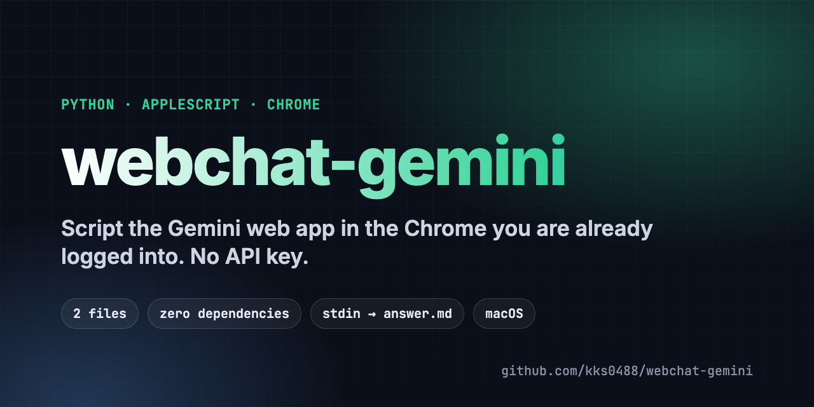
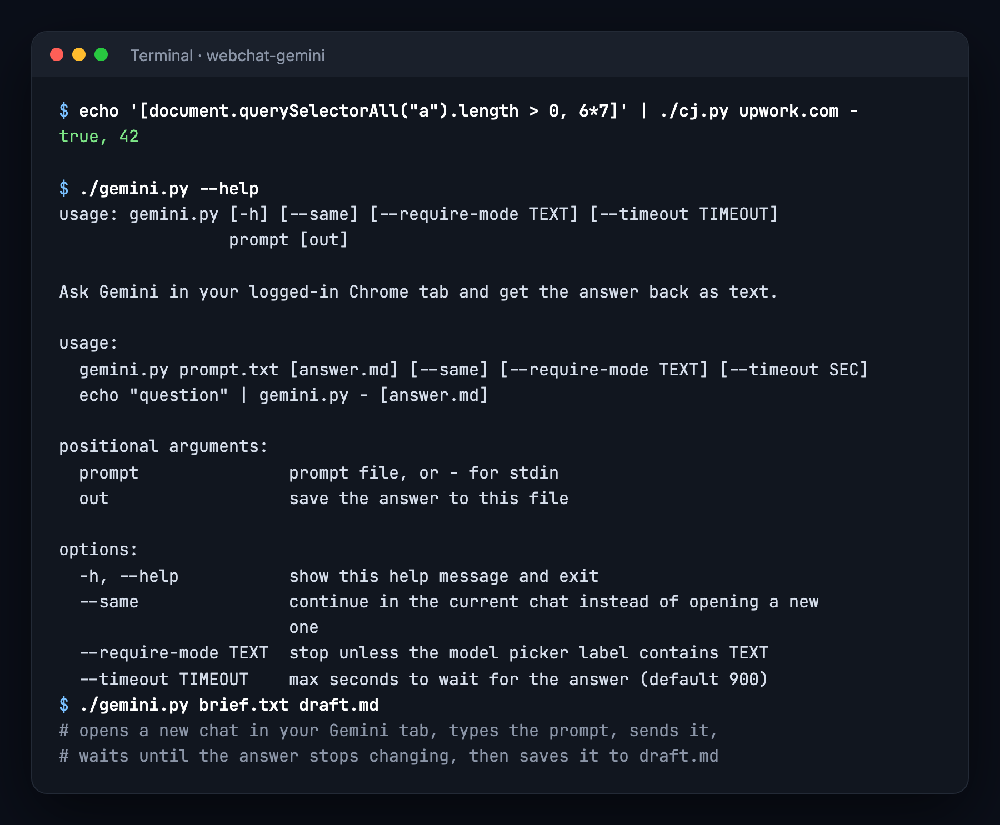

<p align="center">
  
</p>

<p align="center">
  <b>English</b> · <a href="README.ko.md"><b>한국어</b></a>
</p>

<p align="center">
  <a href="LICENSE"></a>
  
  
  
  <a href="https://github.com/kks0488/webchat-gemini/stargazers"></a>
</p>

<h2 align="center">Use the Gemini you already pay for, from the command line.<br>No API key, no headless browser, no extra login.</h2>

<p align="center">
  Two small Python scripts that drive the Chrome window you are already using.<br>
  Hand a prompt file to Gemini, wait for the full answer, save it as Markdown.
</p>

<table>
<tr>
<td width="50%" valign="top">

### `cj.py` — JavaScript in any tab
Find the first Chrome tab whose URL contains a string and run JavaScript in it. Prints the result. Works for any site, not only Gemini.

</td>
<td width="50%" valign="top">

### `gemini.py` — prompt in, answer out
Opens a new chat (or continues with `--same`), types the prompt, presses Send and waits until the answer stops changing.

</td>
</tr>
<tr>
<td width="50%" valign="top">

### Uses your real session
Runs inside your normal Chrome profile, so your Gemini plan, model picker and history are the ones you see on screen.

</td>
<td width="50%" valign="top">

### Built for pipelines
Read the prompt from a file or stdin, write the answer to a file, exit non-zero on failure. Optional `--require-mode` guard stops if the wrong model is selected.

</td>
</tr>
</table>

<p align="center">
  
</p>

## Quick start

1. In Chrome: **View → Developer → Allow JavaScript from Apple Events** (one time).
2. Keep one tab open on `https://gemini.google.com`.
3. Run:

```bash
git clone https://github.com/kks0488/webchat-gemini.git
cd webchat-gemini

echo "Summarize the pros and cons of SQLite in 5 bullets" | ./gemini.py - answer.md
./gemini.py brief.txt draft.md --same          # continue in the same chat
echo 'document.title' | ./cj.py github.com -   # run JS in any tab
```

macOS will ask once for permission to control Google Chrome.

## How it works

`cj.py` passes your JavaScript to `osascript`, which calls Chrome's `execute javascript` on the matching tab. `gemini.py` uses it to fill the Gemini editor, click Send (English or Korean UI), and poll every 5 seconds until the newest response is unchanged twice and the Stop button is gone.

## FAQ

**Does it need the Gemini API?** No. It uses the web app in your browser, so usage follows your Gemini account.

**Windows or Linux?** Not yet. It depends on AppleScript.

**It stopped working after a Gemini update.** The scripts rely on page selectors (`.ql-editor`, `model-response`, the Send button label). Update them in `gemini.py` if Google changes the page.

Use it with your own account and follow Google's terms for your plan.

## License

MIT © Kyoungsoo Kim — see [LICENSE](LICENSE).
